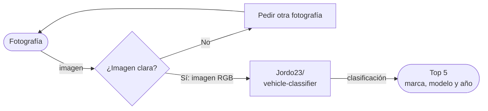

# CHESSCAR: Adivina tu carro en menos de lo que canta un gallo

**Proyecto integrador · Herramientas de IA**
**Grupo:** A1 · **Equipo:** 1

Es un sistema proveedor de identificación vehicular diseñado para la administración de seguros. Resuelve la necesidad de valuar rápidamente un automóvil (identificando su marca, modelo y año) para calcular el porcentaje, límite o presupuesto que la empresa aseguradora le puede asignar al usuario.

## 2. Equipo

| Nombre completo | Papel en el proyecto |
| :--- | :--- |
| Raúl Chessani | Busqueda de la necesidad |
| Erik Aguirre | Busquedad del módelo de IA |
| Cristopher Córtes | Clasificación del módelo |
| Daniel Juaréz | Implementación del módelo |

## 3. Problemática
Las administradoras de seguros enfrentan demoras y posibles imprecisiones al momento de identificar la marca, modelo y año exacto de los vehículos para determinar los límites de sus pólizas asegurables.
[Enlace a la investigación](docs/investigacion.md)

## 4. Caso de uso
* **Usuario:** Administrador de seguros / empresa aseguradora.
* **Entrada:** Fotografías del vehículo (Imágenes).
* **Salida:** Texto que incluye el Top 5 de predicciones de marca, modelo y año del automóvil.

## 5. Modelo abierto elegido

| Dato | Respuesta |
| :--- | :--- |
| **Identificador** | [Jordo23/vehicle-classifier](https://huggingface.co/Jordo23/vehicle-classifier) |
| **Tarea (pipeline tag)** | `image-classification` |
| **Número de parámetros** | $\approx$ 19M |
| **Licencia** | MIT License |
| **Limitación o sesgo declarado** | Condiciones de imagen: Diseñado para fotos claras y bien iluminadas; decae en tomas ocluidas o con ángulos inusuales (cenitales, primeros planos extremos). - Cobertura: Presenta fallos con autos modificados/personalizados o modelos muy antiguos y raros ausentes en VMMRdb. - Alcance: No realiza detección de color de vehículo (debe procesarse aparte). |

## 6. Cómo funciona

## 7. Infraestructura (Viabilidad de hardware)

$$
\text{Memoria mínima} = 19,000,000 \times 2\ \text{bytes} = 38,000,000\ \text{bytes} \approx 38\ \text{MB}
$$

* **Dónde se ejecuta:** Google Colab con GPU.
* **Por qué:** Usamos servidores gratuitos de Google ya que la inferencia de este modelo no necesita un excesivo poder de procesamiento, siendo de apenas ~38MB en memoria base.

## 8. Riesgo ético
* **Riesgo principal:** La Inteligencia Artificial podría utilizarse indebidamente para rastrear ubicaciones personales mediante su integración con cámaras de tránsito públicas (vigilancia masiva).
* **Mitigación:** Limitar su uso al sector privado y cerrado, designando exclusivamente como clientes autorizados a empresas aseguradoras que paguen por el servicio.

## 9. Cambios respecto a la Fase 1
* Se corrigió el cálculo matemático de la memoria mínima para reflejar un valor realista ($\approx$ 38 MB) acorde al número de parámetros.
* Se estructuró y transcribió fielmente la limitación del modelo directamente desde la Model Card para dar mayor claridad a sus fallos de cobertura e iluminación.

## 10. Siguientes pasos
- [ ] Desarrollar e integrar el pipeline de preprocesamiento de imágenes (asegurando el formato RGB).
- [ ] Conectar la API del modelo o cargar los pesos localmente en el entorno de Colab.
- [ ] Diseñar la función para extraer y parsear en texto limpio el Top 5 de predicciones.
- [ ] Elaborar pruebas con el dataset utilizando ángulos inusuales para medir la caída de exactitud reportada en la Model Card.

## 11. Referencias
* Repositorio del modelo elegido: [Jordo23/vehicle-classifier en Hugging Face](https://huggingface.co/Jordo23/vehicle-classifier)