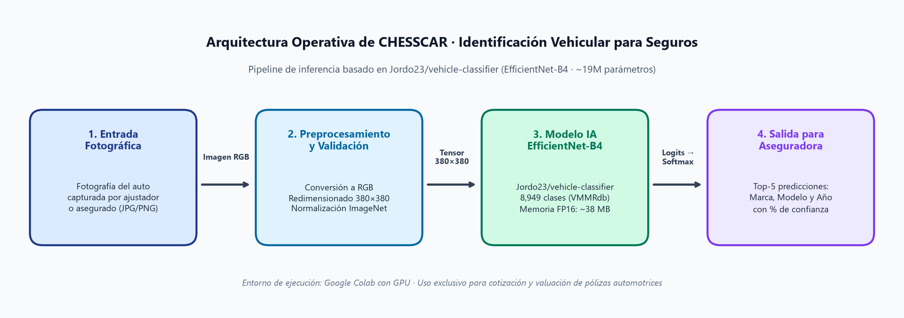
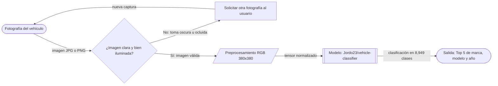

# 1. CHESSCAR: Adivina tu carro en menos de lo que canta un gallo

**Proyecto integrador · Herramientas de Procesamiento para IA (IN1050)**  
**Grupo:** A1 · **Equipo:** 1

**CHESSCAR** es un sistema inteligente de identificación vehicular diseñado específicamente para administradoras de seguros, suscriptores de pólizas y ajustadores de siniestros automotrices. Resuelve la necesidad operativa de identificar y valuar con rapidez y precisión un automóvil a partir de una fotografía —determinando su marca, modelo y año— con el objetivo de agilizar el cálculo del valor comercial, el límite de responsabilidad o el presupuesto de aseguramiento que la compañía aseguradora puede asignar a un cliente, reduciendo errores de captura manual y tiempos de respuesta en cotizaciones e inspecciones.

## 2. Equipo

| Nombre completo | Papel en el proyecto | Ficha individual |
| :--- | :--- | :--- |
| Raúl Chessani | Investigación de la problemática, caso de uso y gestión del repositorio | [Ver ficha](equipo/Chess.md) |
| Erik Aguirre | Búsqueda, evaluación comparativa del modelo de IA y análisis ético | [Ver ficha](equipo/erik.md) |
| Cristopher Cortés | Documentación técnica, clasificación del modelo y diseño de diagramas | [Ver ficha](equipo/Cristopher.md) |
| Daniel Juárez | Ingeniería de requerimientos, infraestructura e implementación del modelo | [Ver ficha](equipo/daniel.md) |

## 3. Problemática

En México, el parque vehicular supera los 58 millones de unidades en circulación según el INEGI, de las cuales únicamente alrededor del 30 % cuenta con una póliza de seguro vigente y genera más de 3.6 millones de siniestros viales al año de acuerdo con la Asociación Mexicana de Instituciones de Seguros (AMIS). En este contexto de alta demanda operativa, las administradoras de seguros enfrentan cuellos de botella, demoras e imprecisiones al identificar manualmente la marca, el modelo y el año exacto de los vehículos durante la cotización de pólizas y el ajuste de siniestros; una catalogación errónea entre años-modelo consecutivos o versiones deriva en sobreaseguramiento, infraaseguramiento o disputas en el pago de indemnizaciones. Para consultar el análisis detallado, cifras oficiales y alternativas evaluadas, revisa nuestra [investigación completa de la problemática](docs/investigacion.md).

## 4. Caso de uso

* **Usuario:** Administrador de seguros, ajustador de siniestros o suscriptor de pólizas de una empresa aseguradora.
* **Entrada (qué le da al sistema):** Una fotografía clara del vehículo (archivo de imagen en formato JPG o PNG tomado desde el exterior del automóvil).
* **Salida (qué recibe de vuelta):** Un reporte en texto estructurado con el **Top 5 de predicciones** más probables de **marca, modelo y año** del automóvil (`Make Model Year`), acompañado del porcentaje de confianza de cada predicción para respaldar la valuación de la póliza.

## 5. Modelo

| Dato | Respuesta |
| :--- | :--- |
| **Identificador** | [`Jordo23/vehicle-classifier`](https://huggingface.co/Jordo23/vehicle-classifier) |
| **Tarea (pipeline tag)** | `image-classification` |
| **Número de parámetros** | $\approx 19\text{M}$ ($19,000,000$ parámetros · arquitectura base EfficientNet-B4 vía `timm`) |
| **Licencia** | `MIT` (MIT License - libre para uso personal y comercial) |
| **Limitación (copiada de la Model Card)** | *"Best performance on clear, well-lit photographs. May struggle with: Heavily occluded vehicles; Unusual angles (top-down, extreme close-ups); Very old/rare vehicles not in training data; Heavily modified or custom vehicles. Color detection is handled separately (not part of this model)."*   *(Traducción: Mejor desempeño en fotografías claras y bien iluminadas. Puede presentar dificultades con: vehículos fuertemente ocluidos, ángulos inusuales como tomas cenitales o primeros planos extremos, vehículos muy antiguos o raros ausentes en el conjunto de entrenamiento VMMRdb, y vehículos modificados o personalizados. La detección de color se maneja por separado).* |

## 6. Cómo funciona

## 7. Infraestructura

Tomando como referencia los aproximadamente $19,000,000$ de parámetros declarados en la [Model Card](https://huggingface.co/Jordo23/vehicle-classifier), la memoria estimada para almacenar únicamente los pesos en punto flotante de media precisión ($\text{FP16}$, $2\ \text{bytes}$ por parámetro) es:

$$
\text{Memoria de los pesos} = 19,000,000\ \text{parámetros} \times 2\ \text{bytes} = 38,000,000\ \text{bytes} \approx 38\ \text{MB}
$$

En precisión simple ($\text{FP32}$, $4\ \text{bytes}$ por parámetro), la misma estimación corresponde a aproximadamente $76\ \text{MB}$ para los pesos. Estas cifras no representan toda la RAM o VRAM necesaria para ejecutar el modelo: también se requiere memoria para las imágenes de entrada, las activaciones intermedias y el entorno de ejecución. El tamaño del checkpoint en disco es una medida distinta.

* **Dónde correrá el modelo:** Se propone Google Colab con GPU para el prototipo académico.
* **Por qué:** Permite trabajar en un cuaderno compartido con Python, PyTorch, `timm` y `huggingface_hub`, sin exigir una GPU dedicada en las computadoras del equipo. Antes de evaluar el prototipo, se registrarán el acelerador y los recursos de la sesión.
* **Validación pendiente:** En el Parcial III se medirá el uso máximo de memoria y el tiempo de inferencia, documentando el hardware, la precisión utilizada y el tamaño del lote. Los $38\ \text{MB}$ son una estimación de los pesos en FP16; todavía no se ha medido el consumo total ni la velocidad del prototipo.

## 8. Riesgo ético

* **Riesgo principal:** **Vigilancia masiva no autorizada y sesgo de cobertura en la valuación.** Por un lado, un clasificador granular de vehículos podría integrarse indebidamente con cámaras de tránsito públicas para rastrear desplazamientos de ciudadanos sin su consentimiento. Por otro lado, dado que fue entrenado con el dataset estadounidense VMMRdb, podría presentar menor exactitud en modelos subcompactos o versiones específicas del mercado mexicano, provocando una valuación errónea que perjudique económicamente al asegurado.
* **Mitigación:**
  1. Restringir el sistema exclusivamente a un entorno privado y cerrado para cotización y peritaje de aseguradoras autorizadas (bajo consentimiento del titular del vehículo y eliminando metadatos EXIF de geolocalización de las fotografías).
  2. Mantener un esquema de supervisión humana (*human-in-the-loop*) entregando el **Top 5 de predicciones** con su porcentaje de probabilidad en lugar de una decisión única automatizada, de modo que el ajustador o suscriptor valide el resultado antes de emitir la póliza.

## 9. Cambios respecto a la Fase 1

A partir de la retroalimentación recibida en la Fase 1, realizamos los siguientes ajustes:
* **Corrección del cálculo matemático de memoria:** Se rectificó la fórmula en bloque LaTeX multiplicando los $19,000,000$ de parámetros por $2\ \text{bytes}$, obteniendo un valor realista de $38,000,000\ \text{bytes}$ ($\approx 38\ \text{MB}$) coherente con la arquitectura EfficientNet-B4 y justificando con precisión la elección de Google Colab con GPU.
* **Transcripción fiel de la limitación desde la Model Card:** Se incorporó textualmente el apartado *Limitations* publicado en la Model Card oficial de `Jordo23/vehicle-classifier` (condiciones de iluminación, oclusión, ángulos inusuales, cobertura de modelos raros/modificados y ausencia de detección de color).
* **Alineación del caso de uso y salida Top-5:** Se precisó la entrada (fotografías del vehículo), el usuario meta (administrador/ajustador de seguros) y la salida del sistema enfocada en el **Top 5 de predicciones** de marca, modelo y año (aprovechando la exactitud Top-5 de $75\text{--}80\%$ frente al $\approx 50\%$ de Top-1 en las $8,949$ clases).

## 10. Siguientes pasos

Lista de tareas que el equipo desarrollará durante el **Parcial III**:

- [ ] Configurar el cuaderno base en Google Colab con soporte de GPU e instalar las dependencias (`timm`, `torch`, `torchvision`, `huggingface_hub`, `Pillow` y `gradio`).
- [ ] Implementar el módulo de descarga automática de pesos (`vehicle_classifier.pth` y `class_mapping.csv`) desde el repositorio [`Jordo23/vehicle-classifier`](https://huggingface.co/Jordo23/vehicle-classifier).
- [ ] Desarrollar el pipeline de preprocesamiento de imágenes (conversión a RGB, redimensionamiento a $380 \times 380$ píxeles y normalización con medias y desviaciones estándar de ImageNet).
- [ ] Programar la función de inferencia que decodifique los logits mediante `softmax` y devuelva en formato tabular el Top 5 de marca, modelo y año con sus porcentajes de confianza.
- [ ] Construir una interfaz interactiva para el agente de seguros donde pueda subir la fotografía del vehículo y visualizar el dictamen sugerido junto con alertas de confianza.
- [ ] Realizar pruebas experimentales con fotografías de vehículos en distintas condiciones de iluminación y ángulos para documentar el desempeño real del modelo en la presentación final.

## 11. Referencias

1. **Jordo23.** (2024). *Vehicle Classifier - Dude, What's My Car? (Model Card)*. Hugging Face. [https://huggingface.co/Jordo23/vehicle-classifier](https://huggingface.co/Jordo23/vehicle-classifier)
2. **Tafazzoli, F., Frigui, H., & Nishiyama, K.** (2017). *A Large and Diverse Dataset for Improved Vehicle Make and Model Recognition (VMMRdb)*. IEEE Conference on Computer Vision and Pattern Recognition (CVPR) Workshops. [https://openaccess.thecvf.com/content_cvpr_2017_workshops/w9/html/Tafazzoli_A_Large_and_CVPR_2017_paper.html](https://openaccess.thecvf.com/content_cvpr_2017_workshops/w9/html/Tafazzoli_A_Large_and_CVPR_2017_paper.html)
3. **Instituto Nacional de Estadística y Geografía (INEGI).** (2025). *Parque Vehicular: Vehículos de motor registrados en circulación en México*. [https://www.inegi.org.mx/temas/vehiculos/](https://www.inegi.org.mx/temas/vehiculos/)
4. **Asociación Mexicana de Instituciones de Seguros (AMIS).** (2025). *Centro Estadístico del Sector Asegurador y Reportes de Siniestralidad de Autos*. [https://centroestadisticoamis.mx/](https://centroestadisticoamis.mx/)
5. **Comisión Nacional para la Protección y Defensa de los Usuarios de Servicios Financieros (CONDUSEF).** (2025). *Guía y supervisión de Seguros de Automóvil en México*. [https://www.condusef.gob.mx/](https://www.condusef.gob.mx/)
6. **Universidad Iberoamericana León.** (2025). *Reflexionan en Ibero León sobre Inteligencia Artificial y Humanismo a partir de la encíclica Magnifica Humanitas*. [https://www.iberoleon.mx/articulo/reflexionan-en-ibero-leon-sobre-inteligencia-artificial-y-humanismo-a-partir-de-la-enciclica-magnifica-humanitas-1780438257](https://www.iberoleon.mx/articulo/reflexionan-en-ibero-leon-sobre-inteligencia-artificial-y-humanismo-a-partir-de-la-enciclica-magnifica-humanitas-1780438257)

