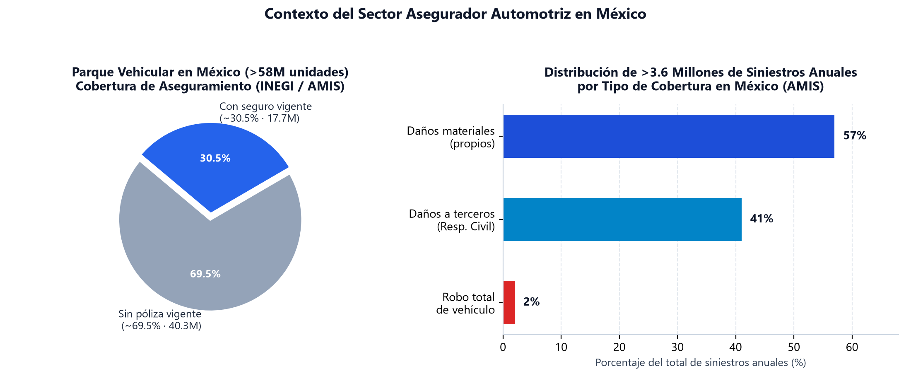
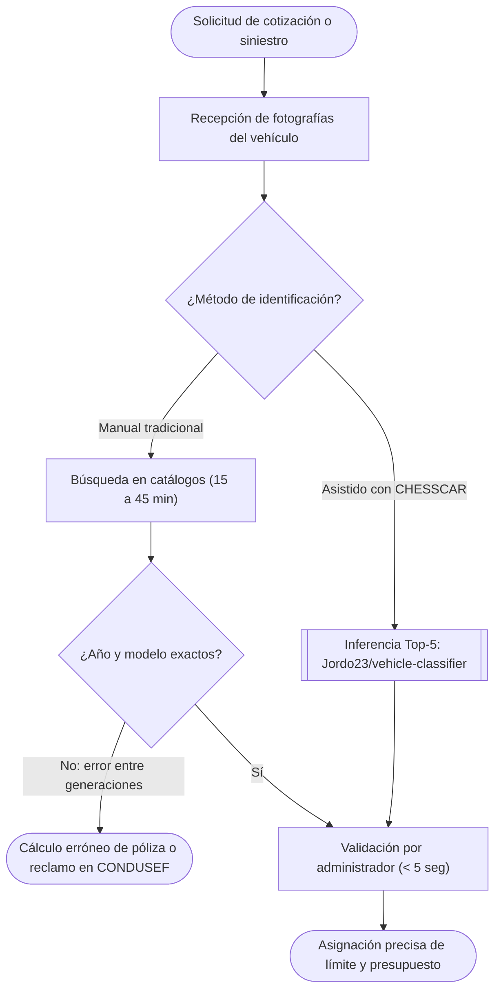
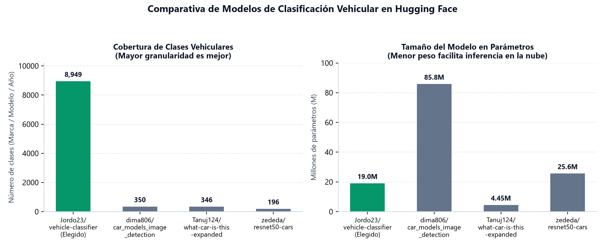

# Investigación de la problemática: Identificación vehicular automatizada para la administración de seguros automotrices (CHESSCAR)

**Curso:** IN1050 · Herramientas de Procesamiento para IA · **Grupo:** A1 · **Equipo:** 1  
**Autores:** Raúl Chessani, Erik Aguirre, Cristopher Cortés y Daniel Juárez

---

## 1. El problema

La suscripción de pólizas de seguro automotriz y la valuación de siniestros viales dependen de un dato crítico: la **identificación exacta de la marca, el modelo y el año (MMY: *Make, Model, and Year*)** del vehículo. Aunque identificar un automóvil parece sencillo, en la operación diaria de las administradoras de seguros constituye un cuello de botella frecuente y costoso. Dos vehículos de la misma línea pueden compartir una carrocería casi idéntica entre años-modelo consecutivos, pero diferir entre un **15 % y un 40 % en su valor comercial**, en el costo de sus refacciones de colisión (faros, fascias, sensores) y en su índice de riesgo.

Cuando un agente suscriptor, ajustador o asegurado cataloga erróneamente el año o modelo de un automóvil, ocurren tres problemas operativos:
1. **Infraaseguramiento o sobreaseguramiento:** Si el vehículo se registra con un año inferior al real, la suma asegurada no cubrirá el valor del bien ante una pérdida total; si se registra por encima, el usuario paga una prima inflada que deriva en inconformidades legales.
2. **Demoras en valuación y ajuste:** Los analistas deben cotejar manualmente fotografías del percance contra extensos catálogos comerciales, retrasando la autorización de reparaciones o indemnizaciones.
3. **Riesgo de fraude en contratación digital:** En esquemas de autogestión, un solicitante puede subir fotografías de un vehículo de año distinto al declarado para alterar el límite o presupuesto de su póliza.

### A quién afecta y magnitud del problema

Esta problemática afecta directamente a las **administradoras y compañías de seguros** (en sus áreas de suscripción, ajuste y valuación), a los **propietarios de vehículos** (que enfrentan retrasos o disputas en sus pólizas) y a los **talleres mecánicos convenidos**. Su magnitud en México se respalda con los siguientes datos oficiales:

* **Parque vehicular superior a 58 millones de unidades (INEGI):** Según el registro de *Vehículos de Motor Registrados en Circulación (VMRC)* del [Instituto Nacional de Estadística y Geografía (INEGI, 2025)](https://www.inegi.org.mx/temas/vehiculos/), México supera los **58 millones de vehículos en circulación** (más de 37 millones de automóviles particulares), coexistiendo modelos de más de dos décadas de antigüedad con lanzamientos recientes.
* **Más de 3.6 millones de siniestros anuales y baja cobertura (AMIS):** De acuerdo con el [Centro Estadístico de la Asociación Mexicana de Instituciones de Seguros (AMIS, 2025)](https://centroestadisticoamis.mx/) y su observatorio [OASIS (AMIS Prensa, 2025)](https://amisprensa.org/), **solo alrededor del 30 % del parque vehicular cuenta con seguro vigente** (3 de cada 10 unidades). Aun así, el sector atiende más de **3.6 millones de siniestros viales al año** (un crecimiento del 38 % en la última década), divididos en **57 % por daños materiales**, **41 % por daños a terceros** y **2 % por robo total**.
* **Reclamaciones por valuación (CONDUSEF):** Según la [CONDUSEF (2025)](https://www.condusef.gob.mx/), el seguro de automóvil encabeza las reclamaciones del sector asegurador mexicano, destacando la inconformidad con el monto de indemnización o valuación y los tiempos de resolución.
* **Complejidad visual de más de 9,000 clases (CVPR):** En la literatura científica, [Tafazzoli et al. (2017)](https://openaccess.thecvf.com/content_cvpr_2017_workshops/w9/html/Tafazzoli_A_Large_and_CVPR_2017_paper.html) demostraron al crear el dataset *VMMRdb* que existen más de **9,000 combinaciones comerciales de marca, modelo y año**, con alta similitud visual entre generaciones consecutivas.

---

## 2. Cómo se resuelve hoy

Actualmente, el sector asegurador emplea procesos manuales, consultas alfanuméricas y software propietario para identificar vehículos. La siguiente tabla compara cuatro alternativas existentes, lo que ofrecen y sus limitaciones:

| Solución o alternativa existente | Tipo | Qué ofrece | Limitaciones principales |
| :--- | :--- | :--- | :--- |
| **1. Inspección visual y cotejo manual con guías (Libro Azul / Guía EBC)** | Proceso manual | El suscriptor o ajustador observa las fotos del auto y busca su marca, modelo y año en guías de precios para fijar la suma asegurada. | **Lento y falible:** Depende de la pericia humana para notar rediseños (*facelifts*) entre años consecutivos; toma de 15 a 45 minutos por caso y no escala masivamente. |
| **2. Consulta de serie (VIN / NIV) y portales públicos (REPUVE)** | Consulta en base de datos | Decodifica los 17 caracteres del VIN para obtener datos de fábrica y estatus legal de robo. | **Sin verificación visual:** Requiere fotografiar de cerca el chasis o contar con la tarjeta de circulación (difícil en daños a terceros) y no valida si la foto exterior corresponde al VIN declarado. |
| **3. Suites corporativas *Insurtech* (Solera Audatex / Mitchell / Tractable)** | Software comercial B2B | Plataformas integrales de valuación de siniestros, catálogos de autopartes y reconocimiento por IA. | **Costo prohibitivo y caja negra:** Licencias corporativas muy costosas en dólares por expediente, inaccesibles para corredurías medianas o desarrollos académicos; modelos cerrados sin posibilidad de auditoría. |
| **4. Apps móviles de aseguradoras con captura guiada** | Aplicación móvil | Guían al cliente con siluetas en pantalla para fotografiar su auto al contratar una póliza. | **Revisión diferida:** En la mayoría de las apps nacionales, las fotos pasan a una fila de *back-office* donde empleados las revisan horas después sin clasificación automática en tiempo real. |

---

## 3. Por qué con IA y por qué este modelo

### Qué hace mejor un modelo de IA

Identificar marca, modelo y año mediante fotografías es una tarea de **clasificación visual de grano fino (*fine-grained image classification*)**. Mientras que una persona puede confundir fácilmente dos años consecutivos de un sedán, una Red Neuronal Convolucional (CNN) entrenada sobre cientos de miles de vehículos analiza patrones geométricos locales en la parrilla, faros, calaveras, rines y silueta del poste C.

El uso de IA permite procesar una imagen en milisegundos, eliminar la fatiga visual del analista y calcular una distribución de probabilidad mediante la función *Softmax* sobre las $K = 8,949$ clases del modelo:

$$
P(y = c \mid x) = \frac{e^{z_c}}{\sum_{j=1}^{8949} e^{z_j}} \quad \text{para } c \in \{1, 2, \dots, 8949\}
$$

Al extraer el **Top 5 de predicciones**, el modelo alcanza una exactitud de **75 % a 80 %** (frente al $\approx 50\%$ en Top-1), reduciendo para el administrador de seguros un universo de casi 9,000 vehículos a 5 candidatos inmediatos con su porcentaje de confianza.

### Comparación con modelos alternativos de Hugging Face

Evaluamos cuatro modelos abiertos en Hugging Face para seleccionar el más adecuado para **CHESSCAR**:

| Modelo en Hugging Face | Parámetros y arquitectura | Licencia | Ventajas | Desventajas |
| :--- | :--- | :--- | :--- | :--- |
| **[`Jordo23/vehicle-classifier`](https://huggingface.co/Jordo23/vehicle-classifier)** *(Elegido)* | **$\approx 19\text{M}$** (EfficientNet-B4 · $\approx 38\ \text{MB}$ en FP16) | **MIT License** (comercial permitida) | Reconoce **8,949 clases** completas de Marca + Modelo + Año (entrenado en VMMRdb con ~280,000 fotos); muy ligero; incluye pesos PyTorch y ONNX. | Exactitud Top-1 de $\approx 50\%$ por similitud entre años (mitigada usando Top-5 de 75–80 %); requiere buena iluminación. |
| **[`zededa/resnet50-cars`](https://huggingface.co/zededa/resnet50-cars)** | **$\approx 25.6\text{M}$** (ResNet-50 · $\approx 94\ \text{MB}$) | **Apache-2.0** (comercial permitida) | Alta exactitud Top-1 ($89.39\%$) en su conjunto de prueba; exportado en ONNX. | **Solo cubre 196 clases** del dataset *Stanford Cars* (autos hasta 2012), insuficiente para el parque vehicular actual. |
| **[`dima806/car_models_image_detection`](https://huggingface.co/dima806/car_models_image_detection)** | **$\approx 85.8\text{M}$** (ViT-Base · $\approx 343\ \text{MB}$) | **Apache-2.0** (comercial permitida) | Buena exactitud ($84.1\%$) para marca y línea general; integración directa con `transformers`. | **No identifica el año del vehículo** (solo $\approx 350$ clases de marca y modelo) y es $4.5\times$ más pesado. |
| **[`Tanuj124/what-car-is-this-expanded`](https://huggingface.co/Tanuj124/what-car-is-this-expanded)** | **$\approx 4.45\text{M}$** (EfficientNet-B0) | **Non-commercial** (CC BY-NC 4.0) | Muy ligero y rápido en CPU; agrupa 346 clases de 42 fabricantes. | **Licencia no comercial** (prohibida para aseguradoras) y baja cobertura de años específicos. |

Elegimos [`Jordo23/vehicle-classifier`](https://huggingface.co/Jordo23/vehicle-classifier) porque ofrece **45 veces más clases** con año específico que `zededa/resnet50-cars`, mantiene un peso compacto gracias a su arquitectura [EfficientNet-B4 (Tan & Le, 2019)](https://arxiv.org/abs/1905.11946) con entrada de $380 \times 380$ píxeles, y cuenta con licencia **MIT** apta para el sector asegurador.

---

## 4. Usuarios y requisitos

### Quién lo usará
* **Suscriptor / Administrador de pólizas:** Valida que la fotografía del vehículo coincida con la marca, modelo y año declarados al cotizar y asignar el límite de cobertura.
* **Ajustador y valuador de siniestros:** Identifica ágilmente unidades siniestradas propias o de terceros para estimar reservas técnicas y presupuestos de indemnización.
* **Analista de prevención de fraude:** Detecta discrepancias entre la documentación presentada y las fotografías del automóvil.

### Lista de requisitos del sistema
1. **RF-01 · Recepción y validación de imagen:** Aceptar fotografías en formato `JPG` o `PNG` y verificar que contengan tres canales de color (`RGB`).
2. **RF-02 · Preprocesamiento a $380 \times 380$:** Redimensionar la imagen a $380 \times 380$ píxeles y normalizarla con los parámetros de ImageNet ($\mu = [0.485, 0.456, 0.406]$, $\sigma = [0.229, 0.224, 0.225]$).
3. **RF-03 · Inferencia con `Jordo23/vehicle-classifier`:** Ejecutar el pase frontal en PyTorch (`timm`) u ONNX sobre las 8,949 clases del modelo.
4. **RF-04 · Reporte del Top 5:** Entregar las 5 predicciones más probables (`Marca Modelo Año`) decodificadas con `class_mapping.csv` y su porcentaje de probabilidad.
5. **RF-05 · Alerta de calidad fotográfica:** Emitir un aviso cuando la confianza sea baja por oclusión, oscuridad o ángulo inusual, solicitando otra toma.
6. **RNF-01 · Rendimiento en la nube:** Ejecutar cada inferencia en **menos de 3 segundos** dentro de Google Colab con GPU utilizando solo $\approx 38\ \text{MB}$ de memoria base ($\text{FP16}$).
7. **RNF-02 · Privacidad por diseño:** Procesar las imágenes en memoria volátil sin almacenar permanentemente fotografías ni metadatos de ubicación de los clientes.

---

## 5. Impacto ético

Sustentamos nuestro análisis ético en la encíclica ***Magnifica Humanitas: Sobre la custodia de la persona humana en el tiempo de la inteligencia artificial***, analizada por académicos de la [Universidad Iberoamericana León (2025)](https://www.iberoleon.mx/articulo/reflexionan-en-ibero-leon-sobre-inteligencia-artificial-y-humanismo-a-partir-de-la-enciclica-magnifica-humanitas-1780438257) y de la [IBERO Ciudad de México (2025)](https://prensa.ibero.mx/es-MX/nota/dignidad-frente-al-algoritmo-el-llamado-del-papa-a-frenar-el-monopolio-de-la-ia), la cual subraya que la IA no es neutral y debe subordinarse siempre a la dignidad humana, evitando tratar a las personas como objetos optimizables.

1. **Privacidad de los datos y vigilancia:** Las fotografías de autos pueden mostrar placas de circulación, rostros de terceros, domicilios y metadatos **EXIF** (coordenadas GPS). Además, existe el riesgo de usar clasificadores vehiculares en cámaras públicas para vigilancia masiva. Para mitigarlo y cumplir con la LFPDPPP, **CHESSCAR** se restringe a un entorno privado de aseguradoras bajo consentimiento del titular, eliminando todo metadato EXIF al transformar la imagen en un tensor RGB y descartando el archivo tras la consulta.
2. **Sesgos heredados y a quién perjudicarían:** El dataset [**VMMRdb**](https://github.com/faezetta/VMMRdb) fue recolectado en Estados Unidos (modelos 1950–2016). Por ello, hereda un **sesgo geográfico y socioeconómico**: autos subcompactos muy comunes en México (*Nissan Tsuru*, *Chevrolet Chevy*, *VW Pointer*) o unidades antiguas con desgaste estético y fotos tomadas con teléfonos de gama baja tienen menor representación o exactitud. Esto perjudicaría a **conductores de menores ingresos**, cuyos vehículos podrían sufrir retrasos o valuaciones imprecisas si el proceso fuera 100 % automatizado.
3. **Quién responde si se equivoca:** Acorde con *Magnifica Humanitas*, la responsabilidad nunca recae en la máquina. **CHESSCAR** funciona bajo supervisión humana (*human-in-the-loop*) ofreciendo un **Top 5 sugerido**. El **ajustador o suscriptor certificado** que valida el expediente y la **compañía aseguradora** (regulada por la CNSF y supervisada por [CONDUSEF](https://www.condusef.gob.mx/)) son quienes responden legal y financieramente ante el asegurado; en caso de baja confianza, es obligatorio verificar el VIN físico.
4. **Costo energético de la infraestructura:** En lugar de emplear modelos multimodales gigantes de alto impacto ambiental, elegimos **EfficientNet-B4** ($\approx 19\text{M}$ parámetros, $\approx 38\ \text{MB}$) ejecutado bajo demanda en Google Colab con GPU NVIDIA T4 ($70\ \text{W}$ TDP). Con un tiempo de inferencia de $\approx 0.02\ \text{s}$ por imagen, el gasto energético es de apenas $E \approx 70\ \text{W} \times 0.02\ \text{s} = 1.4\ \text{Joules}$ ($\approx 3.89 \times 10^{-7}\ \text{kWh}$), evitando además la huella de carbono de reentrenar desde cero las 280,000 imágenes.

---

## 6. Referencias

1. **Jordo23.** (2024). *Vehicle Classifier - Dude, What's My Car? (Model Card)*. Hugging Face. [https://huggingface.co/Jordo23/vehicle-classifier](https://huggingface.co/Jordo23/vehicle-classifier)
2. **Tafazzoli, F., Frigui, H., & Nishiyama, K.** (2017). *A Large and Diverse Dataset for Improved Vehicle Make and Model Recognition*. IEEE CVPR Workshops. [https://openaccess.thecvf.com/content_cvpr_2017_workshops/w9/html/Tafazzoli_A_Large_and_CVPR_2017_paper.html](https://openaccess.thecvf.com/content_cvpr_2017_workshops/w9/html/Tafazzoli_A_Large_and_CVPR_2017_paper.html)
3. **Tafazzoli, F.** (2017). *VMMRdb: Vehicle Make and Model Recognition Database*. GitHub. [https://github.com/faezetta/VMMRdb](https://github.com/faezetta/VMMRdb)
4. **Tan, M., & Le, Q. V.** (2019). *EfficientNet: Rethinking Model Scaling for Convolutional Neural Networks*. ICML / arXiv. [https://arxiv.org/abs/1905.11946](https://arxiv.org/abs/1905.11946)
5. **Instituto Nacional de Estadística y Geografía (INEGI).** (2025). *Parque Vehicular: Vehículos de motor registrados en circulación en México*. [https://www.inegi.org.mx/temas/vehiculos/](https://www.inegi.org.mx/temas/vehiculos/)
6. **Asociación Mexicana de Instituciones de Seguros (AMIS).** (2025). *Centro Estadístico del Sector Asegurador: Ramo Automóviles*. [https://centroestadisticoamis.mx/](https://centroestadisticoamis.mx/)
7. **Asociación Mexicana de Instituciones de Seguros (AMIS Prensa).** (2025). *Observatorio Analítico de Siniestros con Seguro (OASIS)*. [https://amisprensa.org/](https://amisprensa.org/)
8. **Comisión Nacional para la Protección y Defensa de los Usuarios de Servicios Financieros (CONDUSEF).** (2025). *Supervisión y estadísticas de Seguros de Automóvil*. [https://www.condusef.gob.mx/](https://www.condusef.gob.mx/)
9. **Universidad Iberoamericana León.** (2025). *Reflexionan en Ibero León sobre Inteligencia Artificial y Humanismo a partir de la encíclica Magnifica Humanitas*. [https://www.iberoleon.mx/articulo/reflexionan-en-ibero-leon-sobre-inteligencia-artificial-y-humanismo-a-partir-de-la-enciclica-magnifica-humanitas-1780438257](https://www.iberoleon.mx/articulo/reflexionan-en-ibero-leon-sobre-inteligencia-artificial-y-humanismo-a-partir-de-la-enciclica-magnifica-humanitas-1780438257)
10. **Universidad Iberoamericana Ciudad de México.** (2025). *Dignidad frente al algoritmo: el llamado del Papa a frenar el monopolio de la IA (Magnifica Humanitas)*. [https://prensa.ibero.mx/es-MX/nota/dignidad-frente-al-algoritmo-el-llamado-del-papa-a-frenar-el-monopolio-de-la-ia](https://prensa.ibero.mx/es-MX/nota/dignidad-frente-al-algoritmo-el-llamado-del-papa-a-frenar-el-monopolio-de-la-ia)
11. **ZEDEDA.** (2024). *ResNet50 - Stanford Cars Classification (`zededa/resnet50-cars`)*. Hugging Face. [https://huggingface.co/zededa/resnet50-cars](https://huggingface.co/zededa/resnet50-cars)
12. **Dima806.** (2024). *Car Models Image Detection ViT (`dima806/car_models_image_detection`)*. Hugging Face. [https://huggingface.co/dima806/car_models_image_detection](https://huggingface.co/dima806/car_models_image_detection)
13. **Tanuj124.** (2025). *What Car Is This Expanded (`Tanuj124/what-car-is-this-expanded`)*. Hugging Face. [https://huggingface.co/Tanuj124/what-car-is-this-expanded](https://huggingface.co/Tanuj124/what-car-is-this-expanded)
